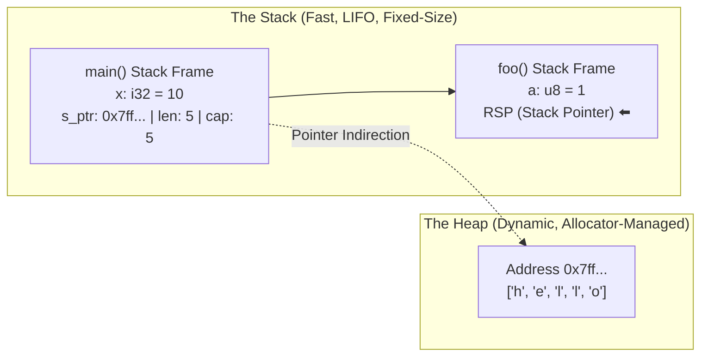
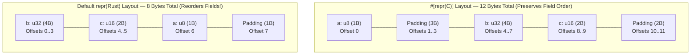

# Episode 1: Introduction to Rust & Systems Thinking (Rust للغلابة)

- **Source:** [مقدمة - Rust للغلابة (Ahmed Farghal / @asoli_dev)](https://youtu.be/N1Ka9EKEGUU)
- **Topic:** Systems Programming Fundamentals, Memory Layout, Stack vs. Heap, and Rust's Mental Model

---

## 1. Why Learn Rust? (It's About the Mindset, Not the Syntax)

Most of us coming from high-level languages (Python, JS, Java, C#) struggle with Rust at first—not because the syntax is weird, but because **we are used to languages lying to us about how the machine actually works.**

In a Garbage Collected (GC) language, you create an object, pass it around, and never ask:
- *How many bytes does this actually take in RAM?*
- *Does this live on the Stack or the Heap?*
- *Who is responsible for cleaning this up, and when?*

> [!important] The Core Takeaway
> Learning Rust forces you to strip away the magic and think like a **Systems Engineer**. The compiler errors you fight in the beginning aren't arbitrary rules—they are hardware and OS realities (memory lifetimes, alignment, pointer aliasing) made visible at compile time.

### The Language Trade-off Spectrum

| Category | Examples | Pros | The Hidden Tax |
| :--- | :--- | :--- | :--- |
| **Managed / GC** | Python, JS, Java, Go | Fast to write, memory-safe by default | Runtime overhead, GC pauses, pointer indirection everywhere, high RAM usage |
| **Classical Systems** | C, C++ | Bare-metal speed, full control over memory layout | Footguns everywhere: segfaults, use-after-free, double-free, data races |
| **Rust's Sweet Spot** | **Rust** | C/C++ speed and control **+ compile-time memory safety** | Steeper learning curve; you pay the "thinking tax" upfront while writing code |

---

## 2. Toolchain & Ecosystem Basics

When you install Rust via `rustup`, you get a clean set of tools:

- **`rustup`**: The toolchain multiplexer. Manages compiler versions (`stable`, `nightly`), targets (e.g., cross-compiling to ARM or WebAssembly), and components.
- **`rustc`**: The raw Rust compiler (`Source Code -> AST -> HIR -> MIR -> LLVM IR -> Native Machine Binary`). You rarely invoke `rustc` directly in real projects.
- **`cargo`**: The build system, package manager, and test runner rolled into one.
  - `cargo new <project>` — Scaffolds a binary (`--bin`, default) or library (`--lib`).
  - `cargo check` — Runs the type and borrow checker **without** generating machine code (super fast for quick feedback).
  - `cargo build` — Compiles unoptimized binary into `target/debug/` (fast compile time, slow runtime, includes debug symbols).
  - `cargo build --release` — Runs heavy LLVM optimizations into `target/release/` (slower compile time, maximum runtime speed).
  - **`Cargo.toml` vs. `Cargo.lock`**: `Cargo.toml` defines your desired dependency ranges; `Cargo.lock` pins the exact resolved versions so builds are 100% reproducible.

> [!question] Why is Rust's Standard Library (`std`) so small compared to Go or Python?
> Rust intentionally keeps `std` minimal (no built-in HTTP server, no built-in async executor—we use community crates like `tokio` or `serde`).
> 1. **Stability guarantee:** Once something enters `std`, Rust can never make breaking changes to it. Libraries like `tokio` evolve much faster outside `std`.
> 2. **Embedded & Kernel support (`no_std`):** Rust runs on bare metal without an OS. Splitting core language primitives (`core`) from OS abstractions (`std`) keeps the language portable everywhere.

---

## 3. Wait... Why is `println!` a Macro (`!`) and Not a Function?

When you write your first Rust program:

```rust
fn main() {
    let x = 42;
    println!("The value of x is: {}", x);
}
```

Why the exclamation mark `!`? That means `println!` is a **Macro**, not a regular function.

- **The Problem with Regular Functions:** In Rust, a normal function **must** have a fixed number of arguments and fixed types known at compile time. You cannot write a regular Rust function that takes 1 argument on one line and 5 arguments of different types (`&str`, `i32`, `bool`) on the next line (unlike JS `console.log(...args)` which boxes everything at runtime, or C's `printf` which blindly trusts your format string at runtime and crashes if you pass the wrong type).
- **How Macros Solve This:** A macro runs **at compile time**. It reads the `"The value of x is: {}"` string literal, counts the `{}` placeholders, checks that the exact number and types of variables match, and **generates the specialized Rust code** before compilation finishes.
  - If you write `println!("{} {}", x)` (two placeholders, one variable), **it fails to compile** instead of crashing in production!
  - *Tip:* You can use `cargo expand` to see the exact code that macros generate under the hood.

---

## 4. How Memory Actually Works (Hardware $\rightarrow$ OS $\rightarrow$ Process)

To understand Rust, we have to understand where variables actually live.

### RAM is Just a Giant Byte Array
At the hardware level, RAM is nothing more than a massive, flat array of bytes indexed by memory addresses (`0x0000`, `0x0001`, ...).
- **Memory has no types:** The byte `01000001` in RAM is just 8 bits. Is it the number $65$ (`u8`)? The letter `'A'` (ASCII)? Part of a larger `i32`? Part of an IPv4 address? **RAM doesn't know.**
- **Types are for the Compiler:** A type in Rust tells the compiler two things:
  1. **How many bytes** to read/write starting at that address.
  2. **How to interpret** those bits (e.g., signed vs. unsigned, integer vs. float).

### Primitive Types in Rust

| Type | Size | Notes |
| :--- | :--- | :--- |
| `u8`, `u16`, `u32`, `u64`, `u128` | $1, 2, 4, 8, 16$ bytes | Unsigned integers ($0$ to $2^n - 1$) |
| `i8`, `i16`, `i32`, `i64`, `i128` | $1, 2, 4, 8, 16$ bytes | Signed integers (Two's Complement, $-2^{n-1}$ to $2^{n-1} - 1$) |
| `usize` / `isize` | Pointer size ($8$ bytes on 64-bit) | Used for indexing arrays/memory addresses; matches CPU architecture |
| `bool` | **$1$ byte** ($8$ bits) | *Why not $1$ bit?* Because CPU memory is **byte-addressable**, not bit-addressable! You can't take a pointer to a single bit. |
| `char` | **$4$ bytes** | Represents a full Unicode Scalar Value (UTF-32 code point), not just 1 ASCII byte! |
| `()` (Unit type) | **$0$ bytes** | Zero-Sized Type (ZST). Takes literally zero space in RAM at runtime. |

### Virtual Memory & The OS Kernel
Your program never touches physical RAM addresses directly. The **OS Kernel** and CPU hardware (MMU) give every process its own isolated **Virtual Address Space**, divided into pages (usually $4\text{ KB}$ each).

---

## 5. The Stack vs. The Heap (Under the Hood)

Inside your process's virtual memory, the two regions we care about most are the **Stack** and the **Heap**.



### 1. The Stack
- **How it works:** Every time you call a function, the CPU pushes a new **Stack Frame** onto the stack to hold all local variables for that function. A dedicated CPU register (**`RSP` — Stack Pointer**) tracks the top of the stack.
- **Why is it insanely fast?**
  - "Allocating" memory on the stack is literally **one CPU instruction**: subtracting the frame size from `RSP`.
  - "Freeing" memory when the function returns is just adding that offset back to `RSP`. Everything above `RSP` is considered dead/garbage and gets overwritten by the next function call.
  - **Cache locality:** The top of the stack is almost always hot in the CPU's L1/L2 cache.
- **The Rule:** To go on the Stack, the compiler **must know the exact byte size at compile time** (`Sized`).

### 2. The Heap
- **When do we need it?**
  1. When the data size is **dynamic** (only known at runtime, like user input, a file read from disk, or a growing `Vec`).
  2. When the data is massive and would cause a `Stack Overflow`.
  3. When data needs to outlive the function that created it without copying it around.
- **What actually happens when you allocate on the Heap?**
  1. Your code calls the **Memory Allocator** (`malloc` / Rust's global allocator).
  2. If the allocator doesn't have enough free space in its current pool, it makes a **System Call** to the OS Kernel (`brk` / `mmap`) to request more $4\text{ KB}$ virtual memory pages.
  3. The allocator searches its internal data structures (free lists / bins) for a chunk big enough, marks it as used, and returns a **pointer (memory address)** to your program.
- **Why is the Heap slower?**
  - Allocator bookkeeping overhead + potential OS context switch (`syscall`).
  - **Pointer Indirection:** You first read the pointer on the Stack, then jump to a random location in RAM (bad for CPU cache prefetcher).

---

## 6. Structs, Memory Alignment, and Padding

Here is one of the coolest low-level details covered in the video: **How does a `struct` actually sit in RAM?**

### Why Memory Alignment Exists
The CPU does **not** read RAM $1$ byte at a time. It reads memory in aligned chunks (words of $4$ or $8$ bytes).
- A $4$-byte integer (`u32`) has an **alignment of $4$**, meaning its memory address **must be a multiple of $4$** ($0, 4, 8, 12, \dots$).
- If a `u32` was stored across addresses `0x01..0x04` (misaligned), the CPU would have to do **two** separate memory reads, mask the bits, and shift them together—hurting performance (or crashing on strict architectures).

### Struct Padding: C (`#[repr(C)]`) vs. Rust (`repr(Rust)`)

Suppose we write this struct:

```rust
struct MyStruct {
    a: u8,  // 1 byte  (alignment: 1)
    b: u32, // 4 bytes (alignment: 4)
    c: u16, // 2 bytes (alignment: 2)
}
```

If you sum the fields naively: $1 + 4 + 2 = 7\text{ bytes}$.
But what does `std::mem::size_of::<MyStruct>()` actually return?



1. **In C (or `#[repr(C)]` in Rust):**
   - The language specification **forces** the compiler to lay out fields in the exact order you typed them (`a`, then `b`, then `c`).
   - `a` goes at offset `0` ($1$ byte).
   - `b` (`u32`) **cannot** start at offset `1` because $1$ is not a multiple of $4$! So the compiler inserts **$3$ wasted padding bytes** (`1..3`), and puts `b` at `4..7`.
   - `c` (`u16`) goes at `8..9`.
   - Finally, the total struct size must be a multiple of its largest field's alignment ($4$), so the compiler adds **$2$ trailing padding bytes** (`10..11`).
   - **Total C Size = $12\text{ bytes}$** ($5\text{ bytes}$ wasted!).

2. **In Default Rust (`repr(Rust)`):**
   - Rust says: *"You care about the field names, not the physical order in RAM."*
   - The Rust compiler **automatically reorders the fields in memory** (largest alignment first: `b: u32`, then `c: u16`, then `a: u8`, plus $1$ byte of trailing padding).
   - **Total Rust Size = $8\text{ bytes}$**! You get optimal memory packing for free without having to manually sort your struct fields like in C.
   - *(Note: If you are doing FFI with C or casting raw network packets from a socket, you explicitly add `#[repr(C)]` so Rust doesn't reorder the fields).*

```rust
use std::mem::{size_of, align_of};

fn main() {
    println!("Size: {}", size_of::<MyStruct>());   // 8 bytes!
    println!("Align: {}", align_of::<MyStruct>()); // 4 bytes!
}
```

---

## 7. Practical Example: Representing Data (IPv4 Address)

Towards the end of the lecture, Ahmed shows how thinking in bytes changes how you model data:
- An IPv4 address like `192.168.1.1` is often lazily stored as a String `"192.168.1.1"` in high-level languages ($11+\text{ bytes}$ on the heap + $24\text{ bytes}$ string header on the stack = $35+\text{ bytes}$!).
- In reality, an IPv4 address is literally just **$4\text{ bytes}$**: `[u8; 4]` or a single `u32` ($4\text{ bytes}$ total on the stack, zero heap allocations!).
- Understanding how bytes sit in memory (and **Endianness**: Big-Endian network byte order vs. Little-Endian x86 CPU byte order) lets you write code that is orders of magnitude faster and leaner.

---

## Summary Checklist Before Moving to Video 2
- [x] Understand why `println!` is a macro (`!`) and why regular Rust functions don't do variadic mixed-type arguments.
- [x] Understand the difference between `cargo check`, `cargo build`, and `cargo build --release`.
- [x] Visualize how the **Stack** (`RSP` pointer bumping, fixed compile-time size) vs. **Heap** (allocator + OS kernel syscalls + pointer indirection) work.
- [x] Understand **Memory Alignment**, **Struct Padding**, and why Rust reorders struct fields by default (`repr(Rust)` vs `#[repr(C)]`).