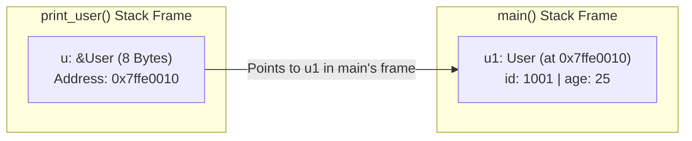
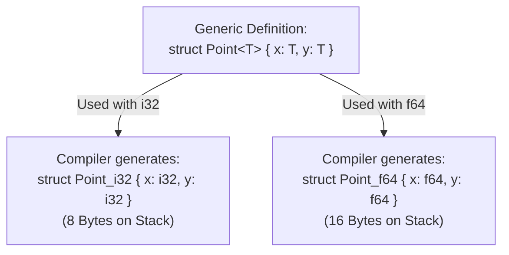

# Episode 2: References, Traits, and Simple Type Generics (Rust للغلابة)

* **Source:** [References and Traits - Rust للغلابة (Ahmed Farghal / @asoli_dev)](https://youtu.be/Duoc8fqyz48)
* **Topic:** Ownership & Moves, References (`&T` vs `&mut T`), The Borrow Checker Rules, Methods (`impl`), Traits, and Simple Type Generics (`struct<T>`)

---

## 1. The Problem Before References: Ownership & Moves

In Episode 1, we saw how variables sit inside Stack Frames. Now let's ask: **What happens in memory when we assign a struct to another variable, or pass it by value into a function?**

```rust
struct User {
    id: u64,
    age: u8,
}

fn print_user(u: User) {
    println!("User ID: {}, Age: {}", u.id, u.age);
}

fn main() {
    let u1 = User { id: 1001, age: 25 };
    print_user(u1);
    // println!("{}", u1.id); // ❌ COMPILER ERROR: borrow of moved value: `u1`
}
```

Why did the compiler stop us from using `u1` after calling `print_user(u1)`?

### Move Semantics (Rust's Default Behavior)

1. **Single Owner Rule:** Every value in Rust has **one owner** (the variable/scope responsible for cleaning it up when that scope ends).
2. When you pass `u1` into `print_user(u: User)` (or write `let u2 = u1;`), the bytes on the Stack are copied into the new variable, and **ownership moves** from `u1` to `u`.
3. As soon as ownership moves, the compiler marks `u1` in `main()` as **no longer valid**. When `print_user` reaches its closing `}`, `u` goes out of scope and gets cleaned up.
4. **Why is Move the default instead of keeping both variables valid?**
   * If the struct owns data on the Heap (like a `String` or `Vec`), copying the Stack bytes just copies the pointer address. If both `u1` and `u` stayed valid, both `print_user` and `main` would try to free the exact same Heap address when their scopes end (**Double Free bug!**).
   * Even for pure Stack structs, passing by value means copying bytes from stack frame to stack frame and losing the original variable in the caller unless you return it back out.

> [!tip] Why don't primitive types (`i32`, `u8`, `bool`, `f64`) move when passed to a function?
> Simple primitive types live entirely on the Stack, are tiny, and never own Heap memory. They implement a special marker trait called **`Copy`**. When a type implements `Copy`, assigning it or passing it to a function copies the bits on the Stack while keeping the original variable valid. Custom `struct`s do **not** implement `Copy` by default unless you explicitly add it!

---

## 2. References & Borrowing (`&T` and `&mut T`)

If we want `print_user` to read `u1` (or modify it) **without** taking ownership of it, we pass a **Reference** (which Rust calls **Borrowing**):

```rust
// Immutable Reference (Read-only borrow)
fn print_user(u: &User) {
    println!("User ID: {}, Age: {}", u.id, u.age);
}

// Mutable Reference (Read + Write borrow)
fn birthday(u: &mut User) {
    u.age += 1;
}

fn main() {
    let mut u1 = User { id: 1001, age: 25 };

    print_user(&u1);      // Borrow `u1` immutably
    birthday(&mut u1);    // Borrow `u1` mutably
    print_user(&u1);      // `u1` is still owned by `main()` and valid!
}
```

### What is a Reference Under the Hood?

In RAM, **a Reference (`&T` or `&mut T`) is literally just a memory address (a pointer)** pointing to where the data lives!

* On a $64\text{-bit}$ machine, `&User` is an $8\text{-byte}$ value (`usize`) holding the memory address of `u1`.
* Even if a struct is $1000\text{ bytes}$ on the Stack, passing `&MyBigStruct` only passes $8\text{ bytes}$ (its address).



### How Does a Rust Reference Differ from a C/C++ Pointer?

At runtime (in compiled machine code), a Rust reference `&T` and a C pointer `T*` are the exact same thing: an $8\text{-byte}$ memory address.
The difference is $100\%$ **at compile time**:
* In C/C++, a pointer can be `NULL`, can point to a variable whose stack frame was already destroyed, or can be mutated while something else is reading it.
* In Rust, a reference is **guaranteed to never be null** and **guaranteed to point to valid memory**, enforced at compile time by the **Borrow Checker**.

### Dereferencing (`*`) vs. The Dot Operator (`.`)

When working with a mutable reference to a primitive type, you use the dereference operator (`*`) to follow the address and modify the value:

```rust
let mut x = 10;
let r = &mut x;
*r += 5; // Follow `r` to `x`'s memory address and add 5
```

When working with a reference to a `struct` (like `u: &mut User`), you don't need to write `(*u).age += 1` (or `u->age` like in C). Rust's dot operator `.` **automatically dereferences** the reference for you (`u.age += 1`).

---

## 3. The Borrow Checker Rules

To make references $100\%$ memory-safe at compile time without any runtime Garbage Collector, the Borrow Checker enforces two main rules:

### Rule 1: A Reference Cannot Outlive the Data It Points To (No Dangling References)

```rust
// ❌ DOES NOT COMPILE!
fn dangling() -> &i32 {
    let x = 5;
    &x // Error: `x` lives on `dangling`'s stack frame and dies right here!
}
```

* Because `x` is a local variable inside `dangling()`, its stack frame is popped as soon as `dangling()` returns. Returning `&x` would leave the caller holding a pointer to dead stack memory, so the compiler rejects it.

### Rule 2: Shared XOR Mutable (Aliasing Rules)

For any variable at a given point in your code, you can have **EITHER**:
* **Any number of immutable references (`&T`)** at the same time (multiple readers).
* **OR at most ONE mutable reference (`&mut T`)** (one exclusive writer, and **zero** readers at that moment).

```rust
let mut x = 10;

let r1 = &x;
let r2 = &x;     // ✅ Allowed: multiple immutable borrows (`&T`)

let m1 = &mut x; // ❌ COMPILER ERROR: cannot borrow `x` as mutable while `r1`/`r2` are still used!
println!("{} {}", r1, r2);
```

* **Why can't we have an immutable reference (`&T`) and a mutable reference (`&mut T`) active at the same time?**
  1. Anyone holding an immutable reference `&T` expects the data underneath it **not to suddenly change** while they are reading it.
  2. Even worse (even in a single thread!): if you hold a reference to an element inside a dynamic structure like a `Vec`, and at the same time mutate the `Vec` (`&mut`) by pushing new items, the `Vec` might run out of capacity, allocate a brand-new chunk on the Heap, copy its items over, and **free the old Heap memory**—turning your existing reference into a dangling pointer!
* **Important Note on Scope:** A reference's borrow lasts only until the **last line where that reference is actually used**, not necessarily until the end of the `{ ... }` block. Once `r1` and `r2` are no longer used in later lines, you are free to take `&mut x`.

---

## 4. Struct Methods (`impl`)

Rust doesn't have `class` or inheritance. Instead, you define your data in a `struct`, and attach functions/methods to it inside an **`impl` block**:

```rust
struct Rectangle {
    width: u32,
    height: u32,
}

impl Rectangle {
    // 1. Associated Function (no `self` — called with `Rectangle::new(...)`)
    fn new(width: u32, height: u32) -> Self {
        Self { width, height }
    }

    // 2. Method borrowing `self` immutably (`&self` is short for `self: &Self`)
    fn area(&self) -> u32 {
        self.width * self.height
    }

    // 3. Method borrowing `self` mutably (`&mut self` is short for `self: &mut Self`)
    fn scale(&mut self, factor: u32) {
        self.width *= factor;
        self.height *= factor;
    }

    // 4. Method taking ownership of `self` (`self` is short for `self: Self`)
    fn consume(self) {
        println!("Consumed rectangle of area {}", self.area());
    } // `self` is dropped here!
}
```

* **`Self` (capital `S`):** Inside `impl Rectangle`, `Self` is simply an alias for the type `Rectangle`.
* **How the 3 `self` receivers work:**
  1. **`&self`:** Borrows the struct read-only. You call `rect.area()`, which is just syntactic sugar for `Rectangle::area(&rect)`.
  2. **`&mut self`:** Borrows the struct mutably so the method can modify its fields (requires `let mut rect`). Calling `rect.scale(2)` is syntactic sugar for `Rectangle::scale(&mut rect, 2)`.
  3. **`self` (by value):** Moves ownership of the struct into the method! After calling `rect.consume()`, `rect` is moved and **cannot be used again** by the caller.

---

## 5. Traits: Defining Shared Behavior

How do we express shared behavior across different structs in Rust (similar to interfaces in other languages)? We use **Traits**.

A `trait` defines a set of method signatures (and optionally default implementations) that any type can implement:

```rust
trait Printable {
    // Required method: any type implementing `Printable` must write this
    fn format_text(&self) -> String;

    // Default method: types get this automatically, or can override it
    fn print(&self) {
        println!("{}", self.format_text());
    }
}

struct Book {
    title: String,
    pages: u32,
}

// Implementing the trait for `Book`
impl Printable for Book {
    fn format_text(&self) -> String {
        format!("Book: {} ({} pages)", self.title, self.pages)
    }
}
```

* **Implementing Traits on Existing/Built-in Types:** Unlike Java/C# where a class must declare its interfaces upfront when defined, in Rust you can implement your `Printable` trait even on built-in primitive types like `i32` or `u32` (`impl Printable for i32 { ... }`)!
* **Derivable Built-in Traits (`#[derive(...)]`):**
  Rust provides standard traits like `Debug` (for printing with `{:?}`), `Clone` (for explicit `.clone()`), `Copy` (for automatic bitwise copy on assignment), and `PartialEq` (for `==`). You can auto-implement them on your structs using a derive macro:

```rust
#[derive(Debug, Clone, Copy, PartialEq)]
struct Point {
    x: i32,
    y: i32,
}
```

---

## 6. Simple Type Generics (`struct<T>` and `impl<T>`)

What if we want our `Point` struct to work with `i32`, or `f64`, or `u8` without writing `PointI32`, `PointF64`, `PointU8` over and over? We make the struct **generic over a type `<T>`**:

```rust
struct Point<T> {
    x: T,
    y: T,
}

// Notice why `<T>` is written twice:
// `impl<T>` declares that this impl block has a generic parameter `T`,
// and `Point<T>` says we are implementing methods for the generic `Point<T>`.
impl<T> Point<T> {
    fn new(x: T, y: T) -> Self {
        Self { x, y }
    }

    fn x(&self) -> &T {
        &self.x
    }
}
```

### Specialized vs. Generic `impl` Blocks

With generics in Rust, you can also write methods that only exist for a **specific concrete type** (like `Point<f64>`), or only when `T` implements a specific **Trait**:

```rust
// 1. Methods available ONLY on `Point<f64>`
impl Point<f64> {
    fn distance_from_origin(&self) -> f64 {
        (self.x.powi(2) + self.y.powi(2)).sqrt()
    }
}

// 2. Methods available ONLY when `T` implements `std::fmt::Display`
impl<T: std::fmt::Display> Point<T> {
    fn print_coords(&self) {
        println!("({}, {})", self.x, self.y);
    }
}
```

### How Type Generics Work Under the Hood (Monomorphization)

When you use `Point<i32>` and `Point<f64>` in your code, how does Rust lay them out in memory?



* At compile time, the Rust compiler looks at every concrete type you actually used with `Point<T>` and generates a separate, specialized struct and `impl` methods for each one (**Monomorphization**).
* **Zero Runtime Overhead:** At runtime, there is no generic wrapper or pointer indirection—`Point<i32>` is literally just two `i32`s sitting side by side on the Stack ($8\text{ bytes}$), running just as fast as hand-written concrete code.

---

## Summary Checklist for Video 2

* [x] Understand why passing/assigning non-`Copy` types **moves** ownership by default.
* [x] Understand how **References (`&T` and `&mut T`)** work as $8\text{-byte}$ pointers under the hood while allowing functions to borrow data without taking ownership.
* [x] Know the **Borrow Checker's two core rules**: references cannot outlive their owner, and you can have *either* many immutable references (`&T`) *or* one mutable reference (`&mut T`) active at a time.
* [x] Understand `impl` blocks and the difference between associated functions (no `self`), `&self`, `&mut self`, and consuming `self`.
* [x] Know how **Traits** define shared behavior and how `#[derive(...)]` auto-generates standard traits like `Debug`, `Clone`, and `Copy`.
* [x] Understand how **Type Generics (`struct<T>` / `impl<T>`)** work and how the compiler turns them into concrete types at compile time.