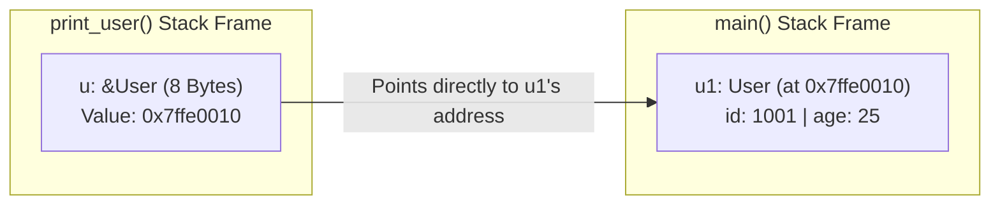
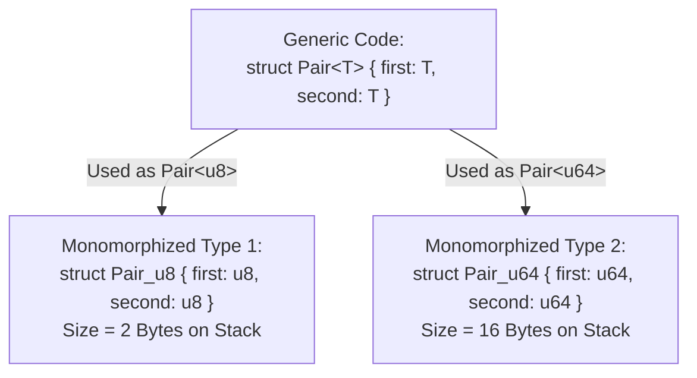
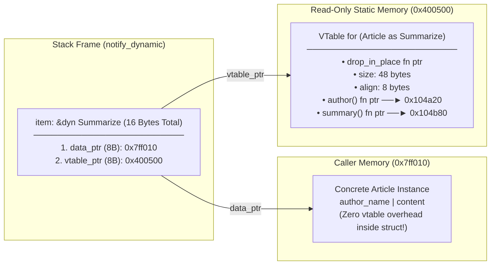

# Episode 2: References, Traits, and Simple Type Generics (Rust للغلابة)

* **Source:** [References and Traits - Rust للغلابة (Ahmed Farghal / @asoli_dev)](https://youtu.be/Duoc8fqyz48)
* **Topic:** Ownership & Moves, References (`&T` vs `&mut T`), The Borrow Checker, Methods (`impl`), Type Generics, and Traits (Static vs. Dynamic Dispatch)

---

## 1. The Problem Before References: Moves vs. Copies

In Episode 1, we saw how variables live inside Stack Frames. Now let's ask a simple question: **What actually happens in RAM when you assign one variable to another, or pass a struct into a function?**

```rust
struct User {
    id: u64,
    age: u8,
}

fn print_user(u: User) {
    println!("User ID: {}, Age: {}", u.id, u.age);
}

fn main() {
    let u1 = User { id: 1001, age: 25 };
    print_user(u1);
    // println!("{}", u1.id); // ❌ COMPILER ERROR: borrow of moved value: `u1`
}
```

Why did Rust refuse to let us use `u1` after passing it to `print_user(u1)`?

### Move Semantics (Rust's Default)
1. **Ownership Rule:** Every value in Rust has a **single owner** (the variable/scope responsible for cleaning it up).
2. When you pass `u1` by value into `print_user(u: User)`, the bytes of `u1` are copied into `print_user`'s stack frame, and **ownership moves to `u`**.
3. The compiler marks `u1` in `main()` as **logically dead/uninitialized**. When `print_user` finishes, `u` goes out of scope and is dropped.
4. **Why is this the default?**
   * If `User` held a pointer to the Heap (like a `String` or `Vec`), and both `u1` and `u` were considered valid owners, both `print_user()` and `main()` would try to `free()` the same Heap memory when they return (**Double-Free vulnerability!**).
   * Even for pure Stack structs, passing big structs by value everywhere means copying bytes (`memcpy`) from stack frame to stack frame, and losing access to your variable in the caller.

> [!tip] Wait—why doesn't `i32` or `bool` move when I pass it to a function?
> Primitive types like `i32`, `u64`, `f64`, `bool`, and `char` live entirely on the Stack, are tiny, and own no Heap resources. They implement a special marker trait called **`Copy`**. If a type is `Copy`, assigning it or passing it to a function duplicates the bits on the stack and keeps the original variable alive. Custom structs are **not** `Copy` by default unless you explicitly opt in!

---

## 2. References & Borrowing (`&T` and `&mut T`)

Instead of giving away ownership of `u1` (or cloning the whole struct), we just want `print_user` to **temporarily look at** `u1` where it already sits in memory. We do this by passing a **Reference** (called **Borrowing** in Rust):

```rust
// Borrows `User` immutably (read-only)
fn print_user(u: &User) {
    println!("User ID: {}, Age: {}", u.id, u.age);
}

// Borrows `User` mutably (read + write)
fn birthday(u: &mut User) {
    u.age += 1;
}

fn main() {
    let mut u1 = User { id: 1001, age: 25 };

    print_user(&u1);      // Pass an immutable reference
    birthday(&mut u1);    // Pass a mutable reference
    print_user(&u1);      // u1 is still alive and owned by main()!
}
```

### What is a Reference Under the Hood in RAM?

At the hardware level, **a Reference (`&T` or `&mut T`) is literally just a raw memory address (a pointer)!**
* On a $64$-bit CPU, `&User` is an $8\text{-byte}$ integer (`usize`) holding the memory address of `u1` in `main()`'s stack frame.
* Even if `User` was $1024\text{ bytes}$ on the stack, `&User` is still only **$8\text{ bytes}$**.



> [!important] C/C++ Pointers vs. Rust References
> At **runtime** (in the compiled assembly), a Rust reference `&T` and a C pointer `const T*` are **identical**—just an $8\text{-byte}$ memory address in a register or on the stack.
> The difference exists $100\%$ at **compile time**: C lets a pointer be `NULL`, point to freed memory, or be mutated from two places at once. Rust's **Borrow Checker** proves your pointers are valid before generating the machine code, and then erases itself completely!

### Dereferencing (`*`) and Auto-Deref (`.`)
If you have a reference to a primitive, you use the dereference operator `*` to follow the pointer and read/write the target value:

```rust
let mut x: i32 = 10;
let r: &mut i32 = &mut x;
*r += 5; // Follow the address in `r` and add 5 to `x`
```

* **Why didn't we write `(*u).age += 1` or `u->age` (like in C) for structs?**
  Because Rust's dot operator (`.`) performs **Auto-Dereferencing**! When you write `u.age`, the compiler automatically follows as many `&` layers as needed (`&&&&User` $\rightarrow$ `User`) to access the field or call a method. No `->` operator needed in Rust!

---

## 3. The Borrow Checker's Golden Rules (And Why They Exist)

To guarantee $0$ memory bugs without a Garbage Collector, the Borrow Checker enforces two strict laws at compile time:

### Law 1: A Reference Must NEVER Outlive Its Owner (No Dangling Pointers)
Suppose you try to write this C-style bug in Rust:

```rust
fn make_dangling_ptr() -> &i32 {
    let x = 42;
    &x // ❌ COMPILER ERROR: returns a reference to data owned by the current function
}
```
* **Why it fails:** `x` lives in `make_dangling_ptr`'s stack frame. The moment the function returns, the CPU bumps the Stack Pointer (`RSP`) back up, destroying that stack frame. If Rust allowed returning `&x`, it would point to garbage stack memory that the next function call will overwrite!

### Law 2: Aliasing $\oplus$ Mutability (Shared XOR Mutable)
At any given point in time for a piece of data, you can have **EITHER**:
* **Any number of immutable references (`&T`)** — multiple readers ($N$ readers, $0$ writers).
* **OR exactly ONE mutable reference (`&mut T`)** — one exclusive writer ($1$ writer, $0$ other readers or writers).

```rust
let mut x = 10;
let r1 = &x;
let r2 = &x;     // ✅ Fine: multiple read-only borrows
let m1 = &mut x; // ❌ ERROR: cannot borrow `x` as mutable because it is also borrowed as immutable
println!("{}, {}", r1, r2);
```

> [!question] Why does Rust ban having a reader (`&T`) and a writer (`&mut T`) at the same time, even in a single-threaded program?!
> Beginners always think this rule is only for multi-threading (Data Races). Actually, it solves two huge **single-threaded** systems problems:
> 1. **Pointer / Iterator Invalidation:** Imagine you have a `Vec<i32>` on the Heap, and you take a read-only reference `let first = &v[0];`. While holding `first`, you call `v.push(99)` (which takes `&mut v`). If the `Vec` is full, `push()` allocates a **new, larger buffer** on the Heap, copies the elements over, and **frees the old buffer**! Suddenly, `first` is a dangling pointer pointing to freed memory! Because of the `Shared XOR Mutable` rule, Rust stops `v.push()` while `first` is still alive.
> 2. **Extreme Compiler Optimizations (`noalias`):** In C/C++, if a function takes `void foo(const int* a, int* b)`, the compiler has to paranoidly reload `*a` from RAM every time `*b` is modified, just in case `a` and `b` point to the exact same memory address! In Rust, the compiler knows with mathematical certainty that `&T` is truly immutable while alive, and `&mut T` is $100\%$ unique (never aliased). It passes LLVM `noalias` flags so values stay cached in CPU registers!

*(Note: Thanks to **Non-Lexical Lifetimes (NLL)** in modern Rust, a borrow's lifetime ends at the **last line where that reference is actually used**, not necessarily at the closing `}` of the scope!)*

---

## 4. Structs, `impl` Blocks, and Methods

Rust is **not** an Object-Oriented language in the Java/C++ sense—there is no `class` keyword and **no struct inheritance**. Instead, Rust cleanly separates **Data Layout** (`struct` / `enum`) from **Behavior** (`impl` blocks).

```rust
struct Rectangle {
    width: u32,
    height: u32,
}

impl Rectangle {
    // 1. Associated Function (No `self` parameter — like a static method / constructor)
    fn new(width: u32, height: u32) -> Self {
        Self { width, height }
    }

    // 2. Immutable Method (`&self` is short for `self: &Self`)
    fn area(&self) -> u32 {
        self.width * self.height
    }

    // 3. Mutable Method (`&mut self` is short for `self: &mut Self`)
    fn scale(&mut self, factor: u32) {
        self.width *= factor;
        self.height *= factor;
    }

    // 4. Consuming Method (`self` is short for `self: Self` — takes ownership!)
    fn destroy(self) -> (u32, u32) {
        (self.width, self.height)
    } // `self` is dropped here!
}
```

### Method Call Syntax is Just Compiler Sugar!
Inside an `impl` block, `Self` (capital `S`) is an alias for the type we are implementing for (`Rectangle`).
When you call a method with dot notation, Rust automatically inserts the `&` or `&mut` for you:

| What You Write | What the Compiler Actually Sees | Receiver Type & Meaning |
| :--- | :--- | :--- |
| `Rectangle::new(10, 20)` | `Rectangle::new(10, 20)` | **No `self`**: Associated function (namespaced under `Rectangle::`). |
| `rect.area()` | `Rectangle::area(&rect)` | **`&self`**: Borrows the struct read-only. Most common. |
| `rect.scale(2)` | `Rectangle::scale(&mut rect, 2)` | **`&mut self`**: Borrows the struct mutably to modify its fields. |
| `rect.destroy()` | `Rectangle::destroy(rect)` | **`self` (by value)**: Moves ownership into the method! The caller can **never** use `rect` again after this call (awesome for closing sockets/files or transforming types!). |

---

## 5. Simple Type Generics & Monomorphization

Suppose we want a container struct `Pair` that holds two values of the same type—sometimes two `i32`s, sometimes two `f64`s, sometimes two `User`s. Instead of copy-pasting the struct definition, we use **Type Generics (`<T>`)**:

```rust
struct Pair<T> {
    first: T,
    second: T,
}

// Notice `impl<T>`: we declare the type parameter T on `impl` first,
// then use it in `Pair<T>`.
impl<T> Pair<T> {
    fn new(first: T, second: T) -> Self {
        Self { first, second }
    }

    fn first_ref(&self) -> &T {
        &self.first
    }
}
```

### How Do Generics Work in Memory? (Monomorphization)
In languages like Java or C# (for reference types), generics often use **Type Erasure** or boxing—wrapping values behind pointers on the Heap so one generic class handles everything at runtime.

Rust does **Monomorphization** at compile time:
* When the compiler sees you use `Pair<u8>` and `Pair<u64>`, it literally **stamps out (copy-pastes)** two separate concrete structs in the compiled binary:



* **The Upside (Zero-Cost Abstraction):** At runtime, `Pair<u8>` is a flat $2\text{-byte}$ struct on the Stack. There is **zero** heap allocation, **zero** boxing, and **zero** runtime type-checking overhead. It runs just as fast as if you wrote `Pair_u8` by hand!
* **The Trade-off:** Because the compiler generates specialized machine code for every concrete type `T` you use, heavy use of generics increases **compile time** and **binary size** (code bloat).

---

## 6. Traits: Shared Behavior & Contracts

Since Rust doesn't have class inheritance, how do we express polymorphism (e.g., *"any type that can be serialized"*, *"any type that can be printed"*, or *"any storage backend that can read/write bytes"*)?

We use **Traits**! A `trait` defines a set of methods (a capability/contract) that a type can implement.

```rust
trait Summarize {
    // Required method: every type MUST implement this
    fn author(&self) -> String;

    // Default method: types get this for free, or can override it
    fn summary(&self) -> String {
        format!("(Read more from {}...)", self.author())
    }
}

struct Article {
    author_name: String,
    content: String,
}

// Implementing the `Summarize` trait for `Article`
impl Summarize for Article {
    fn author(&self) -> String {
        self.author_name.clone()
    }
}
```

### The Orphan Rule (Coherence)
Can you implement *any* trait for *any* type?
* **Yes!** You can even implement *your own* trait on a built-in Rust type like `u32` or `String` (`impl Summarize for u32`)!
* **The One Restriction (Orphan Rule):** To implement `Trait` for `Type`, **at least one** of `Trait` or `Type` must be defined in **your current crate**.
  * *Why?* You cannot implement `std::fmt::Display` (foreign trait) for `Vec<T>` (foreign type) in your code, because if two different libraries did that, the compiler wouldn't know which implementation to call!

### Everyday Standard Library Traits & `#[derive(...)]`
In Rust, even language operators (`+`, `==`, indexing `[]`, dropping values when they go out of scope) are powered by Traits in `std`:
* **`Debug`** (`{:?}` in `println!`): Developer-facing formatting for logs/debugging.
* **`Display`** (`{}` in `println!`): User-facing formatting (must be implemented manually).
* **`Clone` vs. `Copy`**:
  * `Clone` adds the explicit `.clone()` method, which can run arbitrary code (like allocating a new buffer on the Heap).
  * `Copy` (`trait Copy: Clone`) is a marker trait telling the compiler that a simple bitwise stack copy (`memcpy`) is always valid and cheap. *(Note: If your struct contains a `String` or `Vec` that lives on the Heap, the compiler **forbids** you from implementing `Copy`!)*
* **`PartialEq` / `Eq`**: Enables `a == b` and `a != b`.

Instead of writing boilerplate `impl` blocks for standard traits, we use **`#[derive(...)]` macros**, which inspect our struct's fields at compile time and generate the `impl` blocks automatically:

```rust
#[derive(Debug, Clone, Copy, PartialEq, Eq)]
struct Point {
    x: i32,
    y: i32,
}
```

---

## 7. Static Dispatch vs. Dynamic Dispatch (`&dyn Trait` & Fat Pointers)

Suppose we want to write a function `notify` that accepts **any type** that implements the `Summarize` trait. In Rust, we have **two completely different ways** to do this, and as systems engineers, we must know how each one works in memory!

### Way 1: Static Dispatch (Generics / Trait Bounds)

```rust
// Syntax A: Explicit Generic with Trait Bound
fn notify<T: Summarize>(item: &T) {
    println!("Breaking news! {}", item.summary());
}

// Syntax B: `impl Trait` (Syntactic sugar for the exact same thing!)
fn notify_sugar(item: &impl Summarize) {
    println!("Breaking news! {}", item.summary());
}
```
* **How it works:** Uses **Monomorphization**. If you call `notify(&article)` and `notify(&tweet)`, the compiler generates `notify_Article(&Article)` and `notify_Tweet(&Tweet)`.
* **Memory & Speed:** `item` is a normal **$8\text{-byte}$ thin pointer**. The CPU jumps directly to `Article::summary` (or LLVM even **inlines** the method body right into `notify`!). Zero runtime lookup cost.

### Way 2: Dynamic Dispatch (`&dyn Trait` — Trait Objects)

What if you want a single `Vec` that holds *both* `Article`s and `Tweet`s (`Vec<&dyn Summarize>`)? Or what if you want a single compiled function in your binary without duplicating machine code for $50$ types?
You use a **Trait Object (`&dyn Summarize`)**:

```rust
fn notify_dynamic(item: &dyn Summarize) {
    println!("Breaking news! {}", item.summary());
}
```

#### Wait—How Does `&dyn Summarize` Work in RAM?! (The Fat Pointer)
At compile time, `notify_dynamic` has **no idea** whether `item` points to an `Article`, a `Tweet`, or a `u32`. So how does it know which `.summary()` machine code address to jump to?

In Rust, a struct itself does **not** carry a hidden `vptr` inside it (unlike C++ classes with `virtual` methods, which bloat every single object instance in RAM by $8\text{ bytes}$!).
Instead, Rust puts the vtable pointer **inside the reference itself**, turning `&dyn Summarize` into a **$16\text{-byte}$ "Fat Pointer"** ($2 \times \text{usize}$):



```rust
use std::mem::size_of;

fn main() {
    println!("Normal ref (&Article):     {} bytes", size_of::<&Article>());        // 8 bytes!
    println!("Trait Object (&dyn Trait): {} bytes", size_of::<&dyn Summarize>());  // 16 bytes!
}
```

### Static vs. Dynamic Dispatch Comparison

| Feature | Static Dispatch (`&T where T: Trait` / `&impl Trait`) | Dynamic Dispatch (`&dyn Trait`) |
| :--- | :--- | :--- |
| **Pointer Size** | **$8\text{ bytes}$** (Thin Pointer: `[data_ptr]`) | **$16\text{ bytes}$** (Fat Pointer: `[data_ptr, vtable_ptr]`) |
| **Method Resolution** | Resolved at **Compile Time** (Monomorphization) | Resolved at **Runtime** (follows `vtable_ptr` $\rightarrow$ fn ptr) |
| **Compiler Inlining** | **Yes** (LLVM can inline the method call completely) | **No** (opaque indirect jump prevents inlining) |
| **Heterogeneous Collections** | ❌ No (`Vec<T>` can only hold **one** concrete type `T`) | ✅ Yes (`Vec<&dyn Trait>` can mix `Article`, `Tweet`, etc.) |
| **Binary Size** | Larger (duplicates function machine code per type) | Smaller (only one copy of `notify_dynamic` in binary) |

---

## Summary Checklist Before Moving to Video 3

- [x] Understand why assignment/passing by value **moves** ownership by default, and what the `Copy` marker trait does.
- [x] Know that a normal reference (`&T` / `&mut T`) is just an **$8\text{-byte}$ machine pointer** whose safety is proven at compile time by the Borrow Checker.
- [x] Understand the **Shared XOR Mutable** rule (`N` readers OR `1` exclusive writer) and why it prevents single-threaded bugs like pointer invalidation during `Vec` reallocation.
- [x] Distinguish between `Self::func()`, `&self`, `&mut self`, and consuming `self` in `impl` blocks.
- [x] Explain **Monomorphization** (how Rust turns `<T>` generics into zero-cost concrete types at compile time).
- [x] Visualize the memory layout of a **`&dyn Trait` Fat Pointer ($16\text{ bytes}$)**: `data_ptr` ($8\text{ B}$) + `vtable_ptr` ($8\text{ B}$), and why Rust structs don't pay a hidden vtable cost unless borrowed as a trait object.