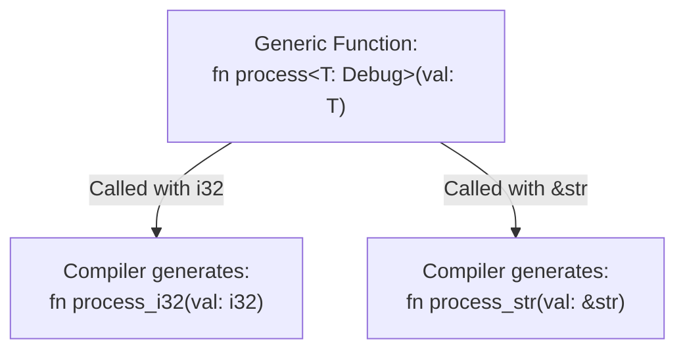
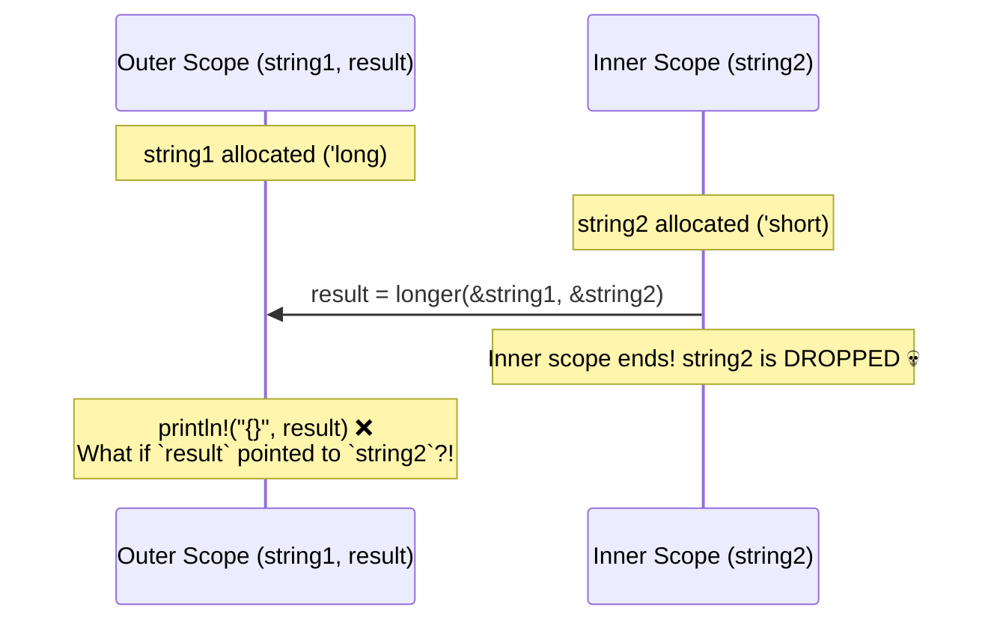

# Episode 3: Generic Functions & Simple Generic Lifetimes (Rust للغلابة)

* **Source:** [Generic Functions - Rust للغلابة (Ahmed Farghal / @asoli_dev)](https://youtu.be/4KP1E_btdrI)
* **Topic:** Generic Functions, Trait Bounds (`where`), Monomorphization vs. Dynamic Dispatch in Functions, and Simple Generic Lifetimes (`'a`)

---

## 1. Moving from Generic Types to Generic Functions

In the previous episode, we saw how to make a `struct` generic over a type `T` (`struct Pair<T>`) and how to attach traits to types. Now, we want to write **standalone functions** that don't care about the exact concrete type passed to them—as long as that type satisfies the behavior our function needs.

### The Problem: Unconstrained `<T>`

If you come from C++, you might think writing a generic function in Rust works like a C++ template where the compiler just substitutes `T` later when you call it:

```rust
// ❌ DOES NOT COMPILE!
fn print_item<T>(x: T) {
    println!("{}", x); // Error: `T` doesn't implement `std::fmt::Display`
}
```

Why does Rust reject this immediately, even before anyone calls `print_item`?

* Because to the Rust compiler, a bare `<T>` means **"literally any type in the universe"**—a number, a struct with no traits, a network socket, etc.
* With a bare `<T>` (no trait bounds), the **only** things you can do with `x` inside the function are:
  1. Move it or return it.
  2. Borrow a reference to it (`&x` or `&mut x`).
  3. Drop it (let it go out of scope).
* You **cannot** print it, compare it (`>` / `==`), add it (`+`), or call any methods on it unless you constrain `T` with a **Trait Bound**.

---

## 2. Trait Bounds on Generic Functions

To tell the compiler what capabilities `T` must have, we add **Trait Bounds** to the generic type parameter.

### 1. Basic Trait Bound Syntax (`<T: Trait>`)

Suppose we want a generic function that compares two items or finds the largest element in a slice:

```rust
fn largest<T: PartialOrd>(list: &[T]) -> &T {
    let mut max = &list[0];
    for item in list {
        if item > max { // ✅ Allowed because `T: PartialOrd` guarantees `>` exists!
            max = item;
        }
    }
    max
}
```

### 2. Multiple Trait Bounds (`+`) and `where` Clauses

What if our function needs `T` to implement more than one trait (for example, both `PartialOrd` to compare items and `std::fmt::Debug` to print them)?

We combine traits using `+`, and when the signature gets crowded, we move the bounds into a **`where` clause** so the function parameters and return type stay easy to read:

```rust
use std::fmt::Debug;

// Inline syntax with `+`
fn compare_and_print<T: PartialOrd + Debug>(a: &T, b: &T) {
    if a > b {
        println!("{:?} is larger", a);
    } else {
        println!("{:?} is larger or equal", b);
    }
}

// Cleaner syntax using `where` (identical to the compiler!)
fn compare_and_print_clean<T>(a: &T, b: &T)
where
    T: PartialOrd + Debug,
{
    if a > b {
        println!("{:?} is larger", a);
    } else {
        println!("{:?} is larger or equal", b);
    }
}
```

### 3. Type Inference & Explicit Type Annotation (`::<T>`)

Usually, when you call a generic function like `largest(&numbers)`, you don't specify `<i32>`—Rust's compiler infers `T` automatically from the arguments you pass (or even from the variable type you assign the return value to!).

However, if the compiler cannot infer `T` from context alone, you can explicitly tell the function which type `T` to use via the **Turbofish syntax (`::<T>`)**:

```rust
let nums = vec![10, 20, 5];
let m = largest::<i32>(&nums); // Explicitly specifying T = i32
```

---

## 3. Under the Hood: Monomorphization of Functions

What actually happens in the compiled binary when you call a generic function with different types?

```rust
fn process<T: Debug>(val: T) {
    println!("{:?}", val);
}

fn main() {
    process(10_i32);
    process("hello");
}
```

Just like with generic structs, the compiler performs **Monomorphization**:



* **Zero Runtime Cost (Static Dispatch):** At runtime, there is no generic `process<T>` function anymore. Each call jumps directly to its specialized machine-code copy (`process_i32` or `process_str`), allowing the compiler to inline and optimize each version for the exact size of `T` on the Stack.
* **The Trade-off:** Every concrete type you call `process()` with generates another copy of the function's machine code in your final executable binary.

### Comparing `<T: Trait>`, `impl Trait`, and `&dyn Trait` in Functions

In Rust, you will see three ways to accept "anything that implements `Trait`" in a function:

```rust
// 1. Generic Type Parameter (Static Dispatch / Monomorphized)
fn foo_generic<T: Debug>(x: &T) {
    println!("{:?}", x);
}

// 2. `impl Trait` in argument position (Syntactic sugar for #1 - Static Dispatch)
fn foo_impl(x: &impl Debug) {
    println!("{:?}", x);
}

// 3. Trait Object (Dynamic Dispatch via 16-byte Fat Pointer + VTable, 1 function copy in binary)
fn foo_dyn(x: &dyn Debug) {
    println!("{:?}", x);
}
```

> [!tip] Subtle difference between `<T: Trait>` and `impl Trait` with 2 arguments:
> * `fn same_types<T: Debug>(a: &T, b: &T)` **forces** `a` and `b` to be the **exact same concrete type** (both `i32`, or both `String`).
> * `fn diff_types(a: &impl Debug, b: &impl Debug)` is actually sugar for `<T: Debug, U: Debug>(a: &T, b: &U)`, allowing `a` to be an `&i32` while `b` is a `&String`!

---

## 4. Simple Generic Lifetimes (`'a`)

In the second half of the video, we hit a super important question that every Rust developer runs into as soon as they write functions that **take references and return a reference**.

### The Problem: Why Does the Compiler Reject This?

Suppose we write a function `longer` that takes two string slices (`&str`) and returns whichever one is longer:

```rust
// ❌ DOES NOT COMPILE: missing lifetime specifier!
fn longer(s1: &str, s2: &str) -> &str {
    if s1.len() > s2.len() {
        s1
    } else {
        s2
    }
}
```

Wait—why is the Borrow Checker complaining here?! Neither `s1` nor `s2` is created inside `longer`, so we aren't returning a dangling pointer to a local variable inside `longer`!

### Thinking Like the Borrow Checker

Remember two fundamental facts about how Rust compiles functions:
1. **Rust checks each function independently based ONLY on its signature** (it does *not* re-analyze the body of `longer` at every call site like C++ templates).
2. Looking only at `fn longer(s1: &str, s2: &str) -> &str`, the caller of `longer` has a huge question:
   * **"Does the returned `&str` point to `s1`'s memory, or `s2`'s memory?"**
   * Because it depends on a runtime `if s1.len() > s2.len()`, **nobody knows at compile time** whether the returned reference came from `s1` or `s2`!

Look at what happens at the call site if `s1` and `s2` live for different amounts of time (different scopes on the Stack):

```rust
fn main() {
    let string1 = String::from("long string is long");
    let result: &str;

    {
        let string2 = String::from("xyz");
        result = longer(string1.as_str(), string2.as_str());
    } // ⚠️ `string2` is dropped here at the end of the inner scope!

    // Is `result` still valid here?!
    println!("The longest string is {}", result);
}
```



### How Generic Lifetimes (`'a`) Solve This

To let the Borrow Checker verify `main()` **without** looking inside `longer()`'s body, we add a **Generic Lifetime Parameter (`'a`)** to the function signature:

```rust
fn longer<'a>(s1: &'a str, s2: &'a str) -> &'a str {
    if s1.len() > s2.len() {
        s1
    } else {
        s2
    }
}
```

### What Does `<'a>` Actually Mean? (Crucial Mental Model!)

> [!important] Lifetimes Do NOT Change How Long Data Lives!
> Adding `'a` does **not** make `string2` live longer in RAM, nor does it generate any runtime code. Lifetimes are $100\%$ compile-time labels for the Borrow Checker!

When we write `fn longer<'a>(s1: &'a str, s2: &'a str) -> &'a str`, we are signing a contract between the function body and the caller:
1. **What `'a` becomes:** For any given call `longer(x, y)`, the generic lifetime `'a` becomes the **intersection (the overlap / the shorter scope)** of `x`'s lifetime and `y`'s lifetime.
2. **Guarantee to the Caller:** The returned reference `&'a str` is guaranteed to be valid **only for that shorter overlapping lifetime `'a`** (while *both* `s1` and `s2` are still alive!).
3. Therefore, in the `main()` example above, since `string2` dies at the end of the inner `{ ... }` block, `'a` ends at that `}`, and the compiler rightly rejects `println!("{}", result)` outside the block!

```rust
fn main() {
    let string1 = String::from("long string is long");

    {
        let string2 = String::from("xyz");
        let result = longer(string1.as_str(), string2.as_str());
        // ✅ VALID HERE! Both `string1` and `string2` are alive in this scope.
        println!("The longest string is {}", result);
    }
}
```

### What If the Return Value Only Depends on ONE Argument?

If a function takes two references `s1` and `s2`, but **always** returns `s1` (say, it just logs `s2` and never returns it), then we **should not** tie `s2` to `'a`!

```rust
// Only `s1` and the return type share `'a`.
// `s2` gets its own independent (anonymous/elided) lifetime!
fn first_word<'a>(s1: &'a str, s2: &str) -> &'a str {
    println!("Ignoring second string: {}", s2);
    s1
}
```

Now, even if `s2` dies immediately in an inner scope, the returned reference from `first_word` stays valid for as long as `s1` is alive!

### Why Didn't We Have to Write `'a` When There Was Only 1 Reference? (Lifetime Elision)

If you write a function that takes **one** reference and returns a reference:

```rust
fn trim_first(s: &str) -> &str {
    &s[1..]
}
```

Why didn't the compiler ask for `<'a>` here?
Because there is **no ambiguity**! Since there is only one input reference `s`, the returned reference `&str` *must* come from `s` (remember: a function can never return a reference to its own local stack variables). For obvious, unambiguous patterns like this, the compiler automatically fills in `fn trim_first<'a>(s: &'a str) -> &'a str` for you behind the scenes (**Lifetime Elision**).

---

## Summary Checklist for Video 3

* [x] Understand why an unconstrained generic `<T>` in a function cannot use operators or methods without **Trait Bounds** (`T: PartialOrd + Debug`).
* [x] Use `where` clauses to keep generic function signatures clean, and `::<T>` (turbofish) when explicit type annotation is needed.
* [x] Understand how generic functions are **monomorphized** at compile time vs. using `&dyn Trait` for dynamic dispatch.
* [x] Understand **why** returning a reference from a function that takes multiple references requires a **Generic Lifetime (`'a`)**.
* [x] Know that `'a` does **not** extend any variable's life at runtime—it tells the Borrow Checker that the returned reference is tied to the **shorter (overlapping) scope** of the inputs marked with `'a`.